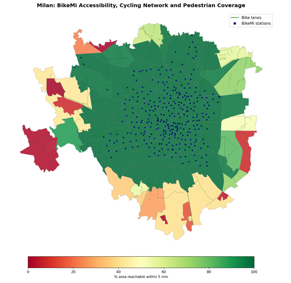

# Cycling Accessibility in Milan: a GIS Analysis of BikeMi and Bike Lanes

Is access to cycling mobility in Milan evenly distributed across neighbourhoods?
This project combines **spatial analysis**, **walking isochrones**, **clustering** and an interpretable **classification model** to map how BikeMi bike-sharing stations and bike lanes are distributed across Milan's **88 neighbourhoods (NIL)**, and to identify where new investment is most needed.

> Group project for the *Data Science Lab on Smart Cities* course — MSc in Data Science, University of Milano-Bicocca (2026).

---

## Key findings

- **Strong centre–periphery gradient**: stations and lanes concentrate in central neighbourhoods (e.g. Duomo: 16.7 stations/km²), while several peripheral areas have none.
- **Polarised service**: clustering splits the NILs into *well served* (30), *total desert* (30), *stations without lanes* (14) and *lanes without stations* (14).
- **Walking access**: on average 82.6% of a neighbourhood's area is within a 5-minute walk of a BikeMi station — but 8 peripheral NILs are below 10%.
- **Lane quality matters**: only 36.6% of the network is physically separated from traffic, while 21.1% is shared with vehicles; the lowest-quality neighbourhoods are peripheral.
- **Socio-economic link (neighbourhood level)**: on the 32 NILs with complete income data, average declared income is positively correlated with BikeMi station density (r = +0.72, p < 0.001), but not with total km of lanes (r = +0.05).
- **Priority areas**: a depth-2 decision tree (79% cross-validated accuracy) flags **16 neighbourhoods** as priorities for new stations, with rules simple enough for policymakers to read.

<!-- Add a map here, e.g.:
<p align="center"></p>
-->

---

## Data

| Dataset | Content | Source |
|---|---|---|
| BikeMi stations | 325 stations with location and opening year (2008–2021) | Comune di Milano open data |
| Bike lanes | 4,154 segments (332.8 km) with lane type and year | Comune di Milano open data |
| NIL boundaries | 88 neighbourhood polygons | Comune di Milano open data |
| Income | total taxable income and taxpayers by postcode (IRPEF, tax year 2022), aggregated to NILs with a taxpayer-weighted spatial join | Comune di Milano, dataset DS2734 |
| Street network | walkable network for isochrones | OpenStreetMap via OSMnx |

---

## Methods

**Five indicators per neighbourhood:**
1. BikeMi station density (stations/km²)
2. Bike lane density (km/km²)
3. Walking coverage: % of the NIL within a 5-minute walk (5 km/h) of the nearest station, using **isochrones on the real street network**
4. Lane quality: % of lanes physically separated from traffic
5. Average declared income (€ per taxpayer)

**Analyses:**
- **Temporal**: growth of stations and lanes 2008–2021, including the 2020 *Strade Aperte* acceleration
- **Spatial**: spatial joins of stations and lanes to NIL polygons, choropleth maps
- **Clustering** of neighbourhoods by station and lane density
- **Correlation** between income and the accessibility indicators
- **Decision tree** (depth 2, 5-fold cross-validation) to classify priority neighbourhoods
- **Policy recommendations**: targeted station expansion, safer peripheral lanes, income-adjusted BikeMi fares, an annual equity dashboard

---

## Repository structure

```
├── notebooks/
│   └── milan_bikemi_accessibility.ipynb   # full analysis
├── data/                                  # open data used in the analysis
├── images/
├── report/
│   ├── essay.pdf
│   └── slides.pdf
└── README.md
```

---

## Limitations

- **Ecological fallacy**: income is a neighbourhood average; correlations describe differences between areas, not between individuals — wealthy and low-income residents live in both central and peripheral NILs.
- **Coarse income data**: income is published for 38 postcodes, not for the 88 NILs; after the spatial join only **32 NILs** have complete data, so the correlations and the classifier rely on a small sample.
- **Declared income** (IRPEF) under-represents capital income and informal activity.
- **Unstable classifier**: with 32 observations, cross-validated accuracy varies widely across folds (±14%); the priority labels are derived from the clustering itself.
- **Supply, not usage**: the analysis measures infrastructure availability, not actual BikeMi trips.

**Next steps:** finer socio-economic data (ISTAT census sections), within-neighbourhood inequality measures and BikeMi trip data.

---

## Tools

Python · GeoPandas · Shapely · OSMnx · scikit-learn · pandas · matplotlib · Google Colab

---

## Authors

- **Carlo Pegoraro** — [GitHub](https://github.com/carlopego14)
- **Davide Fabio Loreti**

### Contributions

| Part | Author |
|---|---|
| Data collection and wrangling, temporal and spatial analysis, isochrones, lane quality | Davide Fabio Loreti |
| Literature review and indicators, socio-economic analysis, decision tree, policy recommendations, visualisations | Carlo Pegoraro |
